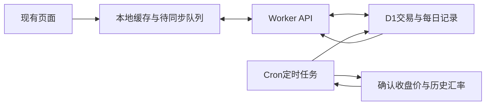

# 前后端联动与现有数据迁移

2026-11-19。用户授权先用模拟数据验证，并询问与现有前端联动及无痛切换。已完成本地Miniflare/workerd+D1内存数据库模拟；尚未实施生产前端、上传真实数据或发布线上版本。用户目前没有Cloudflare账号，实际云端验证需注册并走官方登录流程。

## 联动方式

保留现有网址`https://aixing24.github.io/openbook/`和界面，在数据读写层加入云API、持久化待同步队列与云端历史适配层。

页面启动先加载本地缓存，再拉取已同步数据。交易修改先安全写本地与队列，联网后通过操作ID、版本号同步。收到云端确认前明确显示待同步，不将“本地已保存”误称为“后台已知道”。统计页通过适配层读取云端已确认日记录，保留金额/百分比、零线、排序与主题交互。云端只按已同步账本计算，不自动知道未录入交易或离线尚未同步交易。

当前save()是同步本地写入，不能简单替换成异步fetch然后沿用旧提示；应保留同步本地提交，并异步刷新同步状态。PnlHistory当前是IndexedDB实现，需要新历史仓库/适配器，不把云端收盘记录强塞进capturedAt=date的旧模型。

## 迁移流程

1. 在原网址、原浏览器/主屏幕安装实例中读取旧`cj.v1`与`gaintrace-pnl-history`；冻结一份一致的源备份，账本版本与历史metadata必须匹配。保留交易、分红、费用、券商/备注、交易ID、清仓记录、排序、设置和原始快照。
2. 用户首次登录并启用云同步。显示现有交易数量、持仓、旧记录范围的迁移摘要；不自动将个人账本公开上传，也不让用户重新逐笔输入。
3. 先上传到暂存区，分块记录校验指纹和进度；同一块/同一操作可安全重复请求，中断后续传。本地缓存继续可用，迁移期间的新操作持久化排队，不混入被冻结的源数据。
4. 验证唯一交易ID、内容完整性、数量、设置和同一估值输入下的持仓股数/成本/已实现盈亏，再原子激活云端版本。响应丢失后重试可以查询激活结果，不能重复导入。
5. 前端核对确认后切换至“云同步+本地缓存”，将迁移期间新增操作按版本补发。源本地备份保留，失败或云端已有不同数据时进入明确的核对流程，不能静默覆盖。
6. 云端另行重建每日收盘历史，按日期/标的分批、校验价格和汇率后确认。导入完成与历史补齐完成是两种状态；待补期间不能宣称已恢复全部每日走势。

## 哪些可以无痛保留

| 数据 | 处理 |
|---|---|
| 买卖、分红、费用、券商与备注 | 按既有记录迁移，保留唯一ID |
| 清仓股票和交易记录 | 保留全部交易；持股为零不等于删除 |
| 持仓排序、基准币种、涨跌颜色和主题 | 导入现有设置；设备独有设置可继续留本地 |
| 旧盈亏金额与旧百分比基数 | 原始数据保留，标明采集时点和旧口径 |
| 漏掉的日期或每日收盘值 | 不能凭迁移自动变准确；必须有历史行情、当时账本、汇率及公司行动支持 |
| 浏览器会话里的临时隐私开关 | 当前默认隐藏金额；不是旧S账本里的永久字段，不应假称已迁移云设置 |

无痛指不重新逐笔录入、源数据保留、操作界面延续，并非没有首次登录或不需要确认云同步。

## 日期和网址边界

浏览器本地数据按origin/存储环境隔离。新域名不能直接读取旧域名localStorage或IndexedDB；手机里的数据也不能由开发电脑自动读取。保留现有网址先启用迁移可避免此障碍。如果将来换域名，先在旧站完成账号绑定和上传，再在新站登录读取；旧站不可访问时使用完整JSON备份导入。

旧采集快照与新收盘曲线可能数值不同，这是估值时点不同，应分开标注，不能承诺“每日收盘更准确且所有旧曲线数值丝毫不变”。正常新增未来日期的交易不改变此前已确认快照；回溯编辑应有记录地使受影响点失效并重算，保留旧版本供核验。

## 本地模拟结果

独立原型：`prototypes/cloudflare-migration`。读取真实App的计算和导入校验代码，使用模拟账户、1000笔交易/50个标的、合成价格与内存D1。

17项脚本场景全部通过：未完成上传不切换；账户隔离；断点续传/重复块/冲突块；保留交易成本和清仓记录及设置；重复提交；拒绝覆盖已有不同云数据；拒绝无效旧数据；第二账户隔离；真实scheduled处理器独立执行；行情失败待补及恢复；汇率缺失；未确认价格；离线队列；响应丢失重试不重复交易且正常新增不改历史；陈旧版本/操作ID复用；双设备并发；回溯修正及旧确认值归档。

运行：在原型目录执行`npm run verify`。交互模拟：`npm start`。结果见原型`verification-results.json`。验证后本地模拟运行时已关闭，App仓库源码及线上版本未修改。

原型和结果已归档到独立Git仓库的`prototype/cloudflare-migration`分支，提交`da18e88`（prototype v0.1.0）。该原型仓库沿用现有App项目的本地`.git/hooks`配置，未修改全局Git设置；没有提交或推送到App主分支。

## 剩余验证与限制

Miniflare/workerd本地结果不证明真实Cloudflare CPU10ms限额、定时稳定性或出网质量。本次没有改造实际前端，没有生产登录，队列是原型内存状态，迁移提交验证规模限1000笔，也没有完整交易日历/拆股重建及真实手机端测试。

注册Cloudflare免费账号后，以合成数据做云端CPU、行情/汇率出网、定时任务、客户端访问、故障恢复验证。通过后再实施原网址上的生产适配和真实数据迁移；云端验证用隔离的临时认证，不能直接部署公开固定mock token当正式认证。
